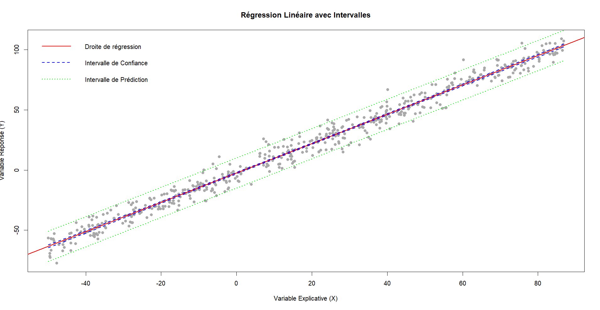
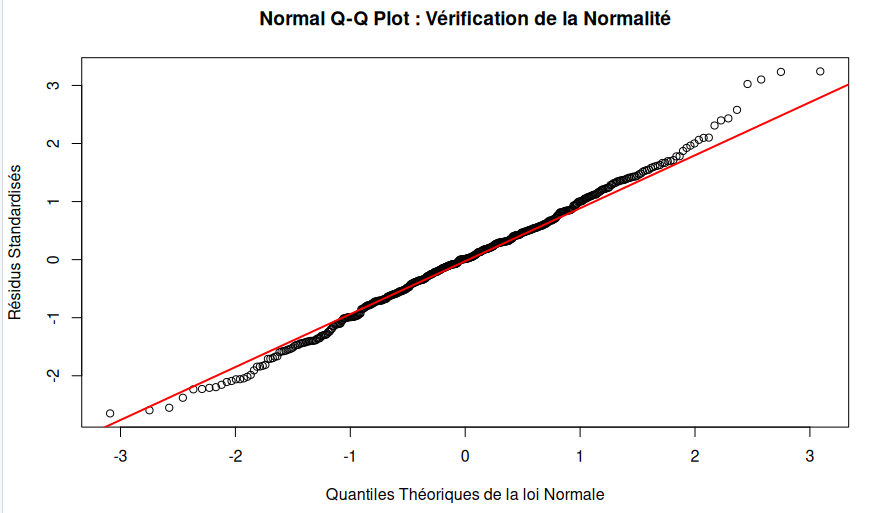
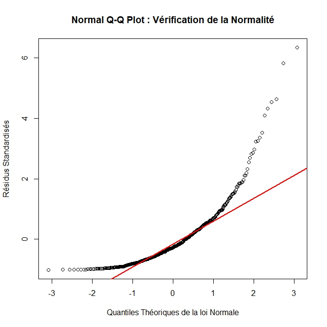
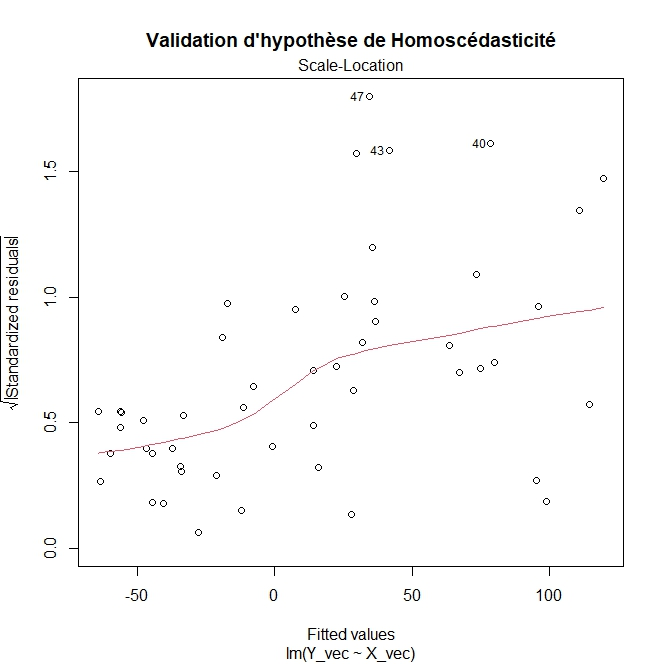
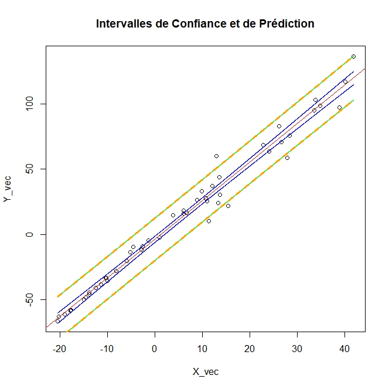
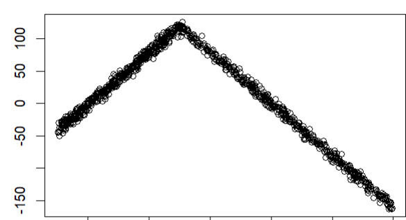
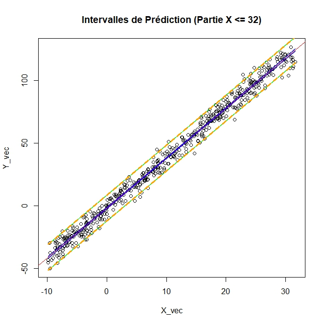
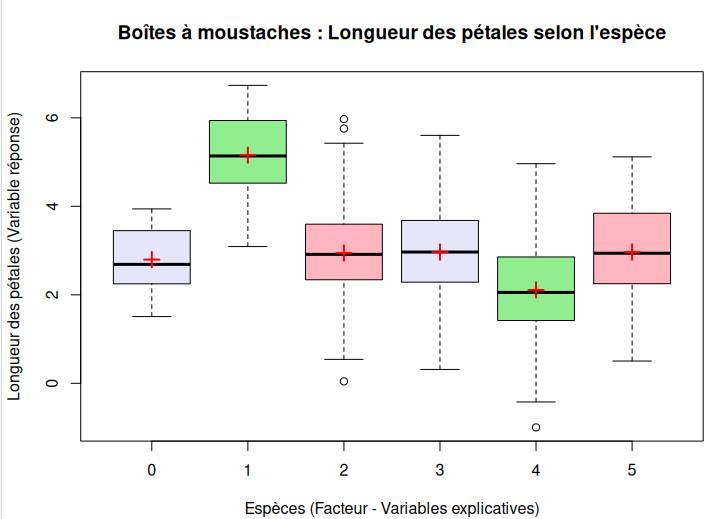
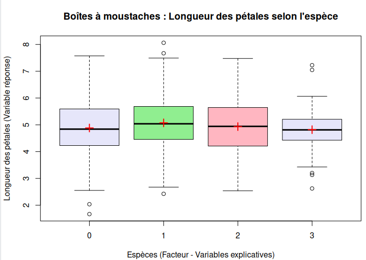
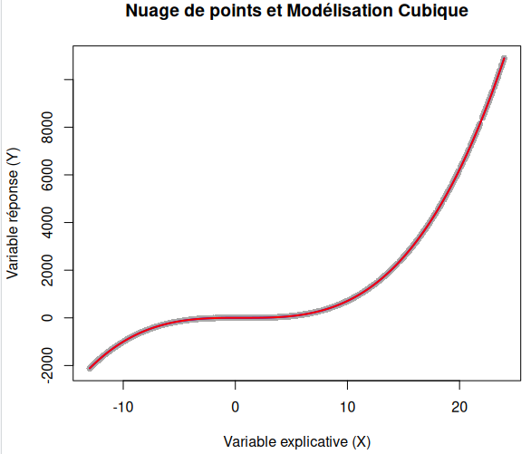

# Régression linéaire en R : de la droite au LASSO

Étude de dix jeux de données avec les modèles de régression linéaire, en vérifiant à chaque fois si le modèle est valide.

<p align="center"></p>

## Objectif

Ajuster un modèle linéaire est facile, une ligne de R suffit. Savoir si on a **le droit de s'en servir** demande plus de travail : c'est le sujet de ce projet d'analyse de données, réalisé à Polytech Nice Sophia.

## Démarche

- Régression linéaire simple, avec les coefficients et les résidus recalculés à la main.
- Vérification des hypothèses sur le bruit (Q-Q plot, test de Kolmogorov-Smirnov, homoscédasticité).
- Régression multiple et sélection de variables : Cp de Mallows, AIC pas à pas, LASSO et ridge.
- Analyse de la variance (ANOVA) et régression polynomiale.

Les sections ci-dessous expliquent chaque méthode et ce qu'elle donne sur les données.

## 1. Le modèle et les moindres carrés

On suppose que la réponse $Y$ dépend de $X$ par une droite, perturbée par un bruit :

```math
Y_i = a\,x_i + b + \varepsilon_i
```

Les **moindres carrés** choisissent la droite qui minimise la somme des carrés des écarts entre les points et la droite. On obtient des formules explicites :

```math
\hat a = \frac{\sum (x_i - \bar x)(y_i - \bar y)}{\sum (x_i - \bar x)^2}, \qquad \hat b = \bar y - \hat a\,\bar x
```

Dans le script, ces coefficients sont recalculés à la main et comparés à ceux de `lm()`, pour vérifier qu'on comprend ce que fait R.

Deux indicateurs disent si la droite est utile :

- le **R²**, la part de la variance de $Y$ expliquée par le modèle (1 = ajustement parfait) ;
- le **test de Student sur la pente** : on teste $a = 0$. Une p-valeur sous 0,05 veut dire que $X$ apporte vraiment de l'information.

Sur le jeu A, on trouve $\hat Y = 1{,}22\,x - 2{,}48$ avec $R^2 = 0{,}98$.

La figure en haut de page montre aussi deux bandes qu'il ne faut pas confondre. L'**intervalle de confiance** (bleu) dit où se trouve la vraie droite. L'**intervalle de prédiction** (vert) dit où tombera une nouvelle observation : il est plus large, parce qu'il ajoute le bruit de cette observation à l'incertitude sur la droite.

## 2. Les hypothèses sur le bruit

Les p-valeurs et les intervalles ci-dessus ne sont justes que si le bruit $\varepsilon$ vérifie quatre hypothèses. Comme on ne voit jamais le bruit, on les contrôle sur les **résidus** (les écarts entre les points et la droite).

| Hypothèse | Ce que ça veut dire | Comment on la vérifie |
|---|---|---|
| Espérance nulle | le modèle ne se trompe pas en moyenne | moyenne des résidus proche de 0 |
| Homoscédasticité | le bruit a la même ampleur partout | graphique *Scale-Location* : la courbe doit rester plate |
| Indépendance | une erreur ne renseigne pas sur la suivante | résidus tracés dans l'ordre : pas de tendance |
| Normalité | le bruit suit une loi gaussienne | Q-Q plot et test de Kolmogorov-Smirnov |

Le **Q-Q plot** compare les quantiles des résidus à ceux d'une loi normale : si le bruit est gaussien, les points s'alignent sur la droite. Le **test de Kolmogorov-Smirnov** mesure le plus grand écart entre la fonction de répartition des résidus et celle de la loi théorique. On l'applique aux résidus *studentisés* (chaque résidu est divisé par son écart-type, estimé sans l'observation concernée), qui suivent une loi de Student.

Les jeux A, B et C ont tous un R² supérieur à 0,96, et pourtant un seul est valide.

<table>
<tr>
<td align="center"><br><b>Jeu A</b> : points alignés, p-valeur de 0,78.<br>Le bruit est gaussien.</td>
<td align="center"><br><b>Jeu B</b> : forte courbure, p-valeur de 10⁻¹⁰.<br>Le bruit n'est pas gaussien.</td>
</tr>
</table>

Pour le jeu B, l'intervalle de prédiction, construit pour un bruit gaussien, ne contient plus 95 % des points aux extrémités.

Le jeu C pose un autre problème : la dispersion des résidus grandit avec les valeurs prédites. C'est de l'**hétéroscédasticité**. L'intervalle de prédiction, de largeur presque constante, laisse sortir 8 % des points au lieu de 5 %.

<table>
<tr>
<td align="center"><br>La courbe rouge monte : la variance n'est pas constante.</td>
<td align="center"><br>Des points sortent de l'intervalle de prédiction.</td>
</tr>
</table>

Ce jeu montre aussi une limite du test de Kolmogorov-Smirnov : avec seulement 50 observations, il accepte la normalité de justesse (p-valeur de 0,057) alors que le Q-Q plot s'écarte nettement aux extrémités. Un test ne remplace pas le graphique.

## 3. Quand une seule droite ne suffit pas

Le nuage du jeu D monte puis redescend. Une droite unique n'aurait aucun sens. En coupant les données en $X = 32$ et en ajustant une droite par morceau, on obtient deux modèles ($R^2 = 0{,}988$ et $0{,}996$) qui vérifient toutes les hypothèses.

<table>
<tr>
<td align="center"></td>
<td align="center"></td>
</tr>
</table>

## 4. Plusieurs variables : lesquelles garder ?

Avec plusieurs variables explicatives, le modèle devient $Y = \beta_0 + \beta_1 X_1 + \dots + \beta_k X_k + \varepsilon$. Ajouter une variable fait toujours monter le R², même si elle ne sert à rien : le modèle se met à coller au bruit des données (**surapprentissage**) et prédit moins bien sur de nouvelles données. Il faut donc choisir.

Un second problème apparaît quand deux variables sont presque identiques : la **multicolinéarité**. Le modèle ne sait pas répartir l'effet entre les deux, les coefficients deviennent instables et aucune des deux ne ressort comme significative. C'est le cas du jeu G, où X1 et X2 sont corrélées à 0,999.

Trois familles de méthodes ont été comparées.

**Le Cp de Mallows (méthode exhaustive).** On ajuste tous les sous-modèles possibles et on calcule pour chacun

```math
C_p = \frac{SCR_p}{\hat\sigma^2} - n + 2p
```

où $SCR_p$ est la somme des carrés des résidus du sous-modèle à $p$ coefficients et $\hat\sigma^2$ la variance estimée avec le modèle complet. Le premier terme récompense l'ajustement, le terme $2p$ pénalise la complexité. On cherche un $C_p$ petit et proche de $p$. La méthode est sûre mais coûteuse : avec $k$ variables il y a $2^k$ sous-modèles.

**Le critère AIC en pas à pas (`stepAIC`).** Même idée de compromis, avec $AIC = n \ln(SCR/n) + 2p$. Au lieu de tout tester, on part du modèle vide et on ajoute ou retire une variable à la fois tant que l'AIC diminue. C'est rapide, mais rien ne garantit de trouver le meilleur sous-modèle.

**La régularisation : ridge et LASSO.** Ici on garde toutes les variables au départ, mais on ajoute aux moindres carrés une pénalité sur la taille des coefficients, réglée par un paramètre $\lambda$ :

```math
\text{ridge :}\quad \min_\beta \; \sum_i (y_i - x_i^T\beta)^2 + \lambda \sum_j \beta_j^2
\qquad\qquad
\text{LASSO :}\quad \min_\beta \; \sum_i (y_i - x_i^T\beta)^2 + \lambda \sum_j |\beta_j|
```

- Le **ridge** pénalise le carré des coefficients. Il les rétrécit tous vers zéro sans jamais en annuler un. Sa solution s'écrit $\hat\beta = (X^TX + \lambda I)^{-1}X^TY$ : le terme $\lambda I$ rend la matrice inversible même quand des variables sont très corrélées, ce qui stabilise les coefficients en cas de multicolinéarité. En revanche il ne fait pas de sélection.
- Le **LASSO** pénalise la valeur absolue. La différence paraît mince, mais elle change tout : cette pénalité met certains coefficients **exactement à zéro**. Le LASSO fait donc la sélection de variables tout seul, ce qui en fait l'outil naturel pour ce projet.

Plus $\lambda$ est grand, plus le modèle est simple. On le choisit par **validation croisée** (`cv.glmnet`) : les données sont coupées en blocs, on apprend sur une partie et on mesure l'erreur sur le reste, pour chaque valeur de $\lambda$. On retient `lambda.1se`, le plus grand $\lambda$ dont l'erreur reste à un écart-type du minimum, c'est-à-dire le modèle le plus simple parmi ceux qui prédisent presque aussi bien que le meilleur.

Résultats sur les trois jeux de données :

| Jeu | Cp de Mallows | stepAIC | LASSO | Modèle retenu |
|---|---|---|---|---|
| E (5 variables) | X1, X5 | X1, X3, X4, X5 | X1 | **Y ~ X1** |
| F (5 variables) | les cinq | les cinq | X1, X3, X4 | **Y ~ X1 + X3 + X4** |
| G (7 variables) | X5 et une ou deux autres | X5, X1, X7 | X1, X2, X5 | **Y ~ X5** |

Les méthodes classiques gardent facilement des variables en trop pour gagner des miettes d'ajustement. Le LASSO est plus sévère. Dans le jeu G, les méthodes se contredisent sur les variables secondaires à cause des deux variables clones, mais toutes s'accordent sur X5, corrélée à 0,997 avec la réponse : elle suffit.

## 5. Variable qualitative : l'ANOVA

Quand $X$ est une catégorie (un groupe), la question devient : la moyenne de $Y$ est-elle la même dans tous les groupes ? L'**analyse de la variance** compare la variabilité *entre* les groupes à la variabilité *à l'intérieur* des groupes, avec un test de Fisher. Si les groupes diffèrent beaucoup par rapport à leur dispersion interne, la statistique $F$ est grande et on rejette l'égalité des moyennes.

<table>
<tr>
<td align="center"><br><b>Jeu H</b> : F = 106,8, p-valeur < 2·10⁻¹⁶.<br>Le groupe a un effet net.</td>
<td align="center"><br><b>Jeu I</b> : F = 2,11, p-valeur = 0,098.<br>Pas d'effet significatif.</td>
</tr>
</table>

## 6. La régression polynomiale

Le nuage du jeu J a une forme de « S ». On ajoute $X^2$ et $X^3$ comme nouvelles variables :

```math
Y = \beta_0 + \beta_1 X + \beta_2 X^2 + \beta_3 X^3 + \varepsilon
```

Le modèle n'est plus une droite, mais il reste **linéaire en ses coefficients** $\beta$ : c'est toujours une régression linéaire multiple, et tous les outils précédents s'appliquent. Les quatre coefficients sont significatifs, $R^2 = 1$ et les résidus sont gaussiens.

<p align="center"></p>

## Bilan

- Un bon R² ne valide pas un modèle. Ce sont les résidus qu'il faut regarder.
- Si le bruit n'est pas gaussien ou si sa variance change, les p-valeurs et les intervalles de prédiction sont faux, même quand la droite colle aux points.
- Entre deux modèles qui expliquent aussi bien les données, le plus simple est le meilleur. Le LASSO et la matrice de corrélation aident à le trouver ; le ridge sert quand on veut garder des variables corrélées en stabilisant leurs coefficients.
- La régression linéaire est plus souple qu'elle n'en a l'air : par morceaux, avec des groupes ou avec des puissances de X.

## Outils

R, avec les packages `MASS`, `leaps` et `glmnet`

## Utilisation

Le code est dans [`regression_lineaire.R`](regression_lineaire.R), à lancer depuis la racine du dépôt. Les données sont dans `data/` (data1 = jeu A, ..., data10 = jeu J) et le rapport complet dans `docs/`.
